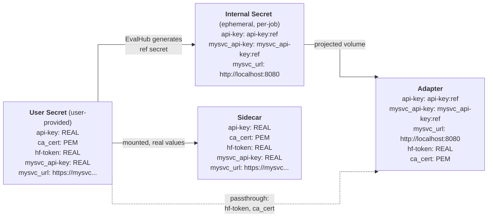

import { Steps, Tabs, TabItem } from '@astrojs/starlight/components';

For Kubernetes jobs, EvalHub routes model traffic through a sidecar proxy running alongside the adapter. The sidecar handles credential resolution and upstream TLS; the adapter receives credential references instead of real model API keys or SA tokens. Local jobs can read real credentials from a `file:///` auth directory.

**Model connection URLs and API keys must not be placed in benchmark `parameters`.** Submit the primary endpoint in `model.url`, reference the model-auth Secret with `model.auth.secret_ref`, and put additional model connections in that Secret as `<role>_api-key` / `<role>_url` pairs. Model identifiers and evaluation settings remain parameters. See [migration and adapter availability](#migration-from-inline-connection-parameters).

## How It Works



> **Note:** The diagram illustrates the `api-key` / `*_api-key` / `*_url` pattern. Other patterns exist — see the scenarios below for details.

All model traffic is routed through the **EvalHub sidecar proxy** running in the same pod as the adapter. You provide credentials in a Kubernetes secret — EvalHub ensures API keys and SA tokens are only visible to the sidecar; `hf-token` and `ca_cert` may be projected to the adapter as passthrough keys. The sidecar resolves and injects credentials into outbound requests on behalf of the adapter.

EvalHub recognizes the following secret keys: `api-key`, `*_api-key`, `*_sa_token`, and `*_url`. When `model.auth.secret_ref` is set and the user secret contains any of these keys, EvalHub generates an ephemeral internal secret where credentials become `:ref` placeholders (e.g. `api-key` → `api-key:ref`). A `*_url` becomes the sidecar address **with the original URL path preserved**: `https://judge.example/api/v1` becomes `http://localhost:8080/api/v1`. The internal secret is created per evaluation job and removed when the Job resource is deleted (Kubernetes GC via owner reference). For `ca_cert`-only or `hf-token`-only secrets no internal secret is created — those keys are passthrough.

The adapter receives a projected volume combining the internal ref secret (when present) with passthrough keys (`hf-token`, `ca_cert`) from the user secret. The user-provided secret with real credential values is mounted only into the sidecar.

You submit the real model URL in `model.url` when creating a job. EvalHub rewrites the adapter's `JobSpec.model.url` to the sidecar, preserving its path in the same way. Auxiliary URLs are read from the projected Secret files, not inserted into `parameters`.

### What is mounted in each container

Both containers use `/var/run/secrets/model`, but receive different volumes:

| File | User Secret / sidecar sees | Adapter sees in Kubernetes |
|---|---|---|
| `api-key` | Real primary-model credential | `api-key:ref` |
| `judge_api-key` | Real judge credential | `judge_api-key:ref` |
| `judge_url` | `https://judge.example/api/v1` | `http://localhost:8080/api/v1` |
| `embedding_api-key` | Real embedding credential | `embedding_api-key:ref` |
| `embedding_url` | `https://embedding.example/v1` | `http://localhost:8080/v1` |
| `hf-token`, `ca_cert` | Original values, if supplied | Original values, passed through |

The adapter's `model-auth-internal` projected volume combines synthetic references
and allowed passthrough files. The raw `model-auth` Secret volume is mounted only
in the sidecar. Unrecognized Secret keys are not automatically exposed to the
adapter. These files are not automatically converted into per-role environment
variables; the adapter must read them using the SDK.

This means:
- Real API keys and SA tokens are only ever seen by the sidecar, not the adapter
- TLS to the model endpoint is handled by the sidecar using `ca_cert` from the secret
- The adapter calls the sidecar URL supplied by EvalHub, including its API path

This guide applies to evaluation jobs created by the Kubernetes runtime. Local runtime behavior may differ.

For an end-to-end workflow covering judge, grader, and scorer model selection and credentials, see [Using Judge and Scorer Models](/guides/judge-and-scorer-models/).

See also: [ODH-ADR-EH-0004 — Eval Sidecar Credential Injection](https://github.com/opendatahub-io/architecture-decision-records/blob/main/architecture-decision-records/eval-hub/ODH-ADR-EH-0004-eval-sidecar-creds-injection.md)

---

## Migration from inline connection parameters

:::note[Adapter image availability]
The Secret-only auxiliary connection and migration behavior for Inspect, DeepEval,
FollowBench, ToolEval, Promptfoo, CLEAR, and ATIF is implemented in
[contrib PR #263](https://github.com/eval-hub/eval-hub-contrib/pull/263), with catalog
and fixture updates in [EvalHub PR #1202](https://github.com/eval-hub/eval-hub/pull/1202).
Deploy adapter images containing those changes with matching provider catalogs;
older images can still read legacy parameters or environment variables. Ragas's
Secret-backed judge/embedding routing is already part of contrib PR #243.
:::

1. Move auxiliary model URLs and API keys from parameters into the matching
   `<role>_url` / `<role>_api-key` Secret entries. Use the exact hyphenated key
   suffix; `judge_api_key` is not a recognized Secret credential key.
2. Keep the primary endpoint in `model.url`, reference the Secret with
   `model.auth.secret_ref`, and leave model IDs and generation settings in
   parameters. Use the [role mapping](/guides/judge-and-scorer-models/#provider-specific-configuration)
   to choose the prefix expected by the adapter.
3. Remove auxiliary URL/key runtime environment variables. When a framework
   needs such variables, the adapter populates them from Secret resolution.
4. Submit a new job after changing the Secret; an already-running sidecar caches
   its values at startup.

Inspect, DeepEval, FollowBench, ToolEval, Promptfoo, CLEAR, and ATIF ignore legacy
connection parameters. Their presence alone does not fail a job, and they never
override or fill missing Secret entries. The [role fallback and validation rules](#scenario-4-multi-model-secrets)
still apply. Connection fields in nested framework model options are removed
while generation settings and unrelated test data are retained.

Remove old credentials from submitted requests and fixture generators even
though they are ignored: job metadata can still persist those inputs. Adapter
references list their specific legacy fields and exceptions, including
[Ragas's standalone local overrides](/adapters/ragas/configuration/#model-auth-secret).

---

## Writing an adapter

### Common case: single model API key

Use `resolve_model_credentials()` — it reads `api-key` from the mounted secret and returns a `ModelCredentials` object. `api_key` is the ref token (e.g. `api-key:ref`), not the real secret value. If no secret is mounted (open model), `api_key` is `None`.

```python
# Inside run_benchmark_job(self, config: JobSpec, ...)
from evalhub.adapter.auth import resolve_model_credentials

creds = resolve_model_credentials()

headers = {}
if creds.api_key:
    headers["Authorization"] = f"Bearer {creds.api_key}"

resp = requests.post(
    f"{config.model.url.rstrip('/')}/chat/completions",
    headers=headers,
    json={...},
)
```

This example assumes the submitted base URL already includes `/v1`. The sidecar
resolves `api-key:ref` to the real API key and forwards the request. If `api_key`
is `None`, an HTTP client can omit Authorization. The sidecar injects its pod SA
token for requests without a credential reference. OpenAI SDK clients require a
non-empty `api_key`; `local` can satisfy that client requirement when no Secret
key exists, but it does not select an auxiliary model route.

### Custom keys (KFP, multi-model, hf-token)

Use `read_model_auth_key(key_name)` to read any key from the secret mount by name. Returns `None` if the key is absent or the secret is not mounted.

```python
from evalhub.adapter.auth import read_model_auth_key

# KFP SA token (Scenario 3)
kfp_token = read_model_auth_key("kfp_sa_token")  # "kfp_sa_token:ref" or None
kfp_url   = read_model_auth_key("kfp_url")        # sidecar address or None

# Multi-model (Scenario 4)
judge_token = read_model_auth_key("judge_api-key")  # "judge_api-key:ref" or None
judge_url   = read_model_auth_key("judge_url")       # sidecar address or None

# HuggingFace token (projected directly — real value, not a ref)
hf_token = read_model_auth_key("hf-token")
```

Handle `None` explicitly — it means the key was not in the secret or no secret was mounted:

```python
if kfp_token is None:
    raise RuntimeError("kfp_sa_token not found in secret mount — check secret_ref")
```

### OpenAI-compatible target, judge and embedding clients

Configure each client with the URL and credential returned by the SDK. The same
code reads synthetic references in Kubernetes and real files in local mode:

```python
from openai import OpenAI
from evalhub.adapter.auth import read_model_auth_key


def model_client(config, role=None):
    key = read_model_auth_key(f"{role}_api-key") if role else None
    url = read_model_auth_key(f"{role}_url") if role else None
    if url and not key:
        raise ValueError(f"{role}_url in model.auth.secret_ref requires {role}_api-key")
    return OpenAI(
        base_url=(url or config.model.url).rstrip("/"),
        api_key=key or read_model_auth_key("api-key") or "local",
    )


target = model_client(config)
judge = model_client(config, "judge")
embedding = model_client(config, "embedding")

judgment = judge.chat.completions.create(
    model=config.parameters["judge_model"],
    messages=[{"role": "user", "content": "Score the supplied answer."}],
)
vectors = embedding.embeddings.create(
    model=config.parameters["embedding_model"],
    input=["The answer to evaluate"],
)
```

Supply OpenAI-compatible base URLs with the correct API path, such as `/v1` or
`/api/v1`; the SDK appends `chat/completions` or `embeddings`. Do not append a
second `/v1`, reconstruct the upstream URL, or change a returned reference token.
The SDK sends the supplied key as `Authorization: Bearer <key>`.

Two role URLs can both read as `http://localhost:8080/v1`. **The Bearer reference
selects the upstream and its credential**, so `judge_api-key:ref` and
`embedding_api-key:ref` must remain distinct even when their projected URLs match.

Adding a new `<role>_api-key` / `<role>_url` pair does not require a sidecar change
for this protocol. The adapter still needs to read that role's files and configure
the appropriate client; the sidecar does not infer roles from model names.

### Framework configuration and subprocesses

Construct auxiliary connections only from the model-auth Secret. Do not read
connection URLs or API keys from `config.parameters` or auxiliary runtime env
variables. If the framework uses environment variables, set them in a subprocess
environment from the resolved Secret values, independently for each role.

Framework passthrough settings can override a correctly configured client. Strip
connection fields such as `api_key`, `apiKey`, `base_url`, and `apiBaseUrl` from
model-option dictionaries, including nested dictionaries and lists, before
forwarding them. Copy the settings, retain generation options such as temperature,
and preserve unrelated test data. Ignore legacy connection fields rather than
failing solely because they are present. Secret validation, including a role URL
without its matching key, still applies.

### Protocol support

The model proxy handles OpenAI-compatible Bearer-authenticated paths including
`/v1/chat/completions`, `/v1/completions`, `/v1/embeddings`, `/v1/models`, and
`/v1/responses`; the upstream must implement the requested API. Adding a role does
not need a new path registration. This does not add native Anthropic `x-api-key`,
Azure `api-key`, or other provider-specific authentication. Use an OpenAI-compatible
gateway when a model's native client needs an unsupported authentication scheme.
Inspect's pinned Ollama client uses OpenAI-compatible `/v1` requests with Bearer
auth, so it can carry the reference; do not infer Ollama from the upstream port
after EvalHub has rewritten the URL to the sidecar.

### Common mistakes

- **Do not expect a real API key from the mount.** In Kubernetes jobs, `api-key` contains `api-key:ref` — a placeholder. The sidecar resolves the real value at request time.
- **Use the role's reference for role routing.** A dummy SDK key or an absent Authorization header cannot select a separate judge/embedding upstream; the sidecar instead uses the primary model route and its SA-token behavior.
- **Use `config.model.url` for the target and `read_model_auth_key("<role>_url")` for other roles.** Both are rewritten to the sidecar inside a Kubernetes job. Do not recover upstream URLs from parameters.

---

## When to use a secret

A secret (`model.auth.secret_ref`) is required if:

- The model requires an API key (`api-key`)
- The endpoint uses a custom CA certificate (`ca_cert`)
- You need a HuggingFace token for gated datasets (`hf-token`)
- You need to call an in-cluster SA-token-authenticated service like KFP (`_sa_token` / `_url`)

If none of the above apply, omit `model.auth`. The sidecar still proxies all model traffic. For SA token-authenticated, RBAC-protected models (Scenario 2), the sidecar injects the pod SA token when the adapter sends no Authorization header.

---

## Scenario 1: API key (and optional CA certificate)

Use this when the model requires an API key, for example a secured vLLM endpoint.

### Secret structure

| Key | Description |
|-----|-------------|
| `api-key` | API key — sidecar injects as `Authorization: Bearer <api-key>` |
| `ca_cert` | PEM CA certificate — sidecar uses for upstream TLS to the model endpoint |
| `hf-token` | HuggingFace token — projected directly to the adapter (HF Hub calls bypass the sidecar) |

At least one of `api-key` or `ca_cert` must be present. A secret containing only `hf-token` is not enough — the HF token is still available to the adapter, but the sidecar will not inject an API key.

```yaml
apiVersion: v1
kind: Secret
metadata:
  name: vllm-api-key
  namespace: team-a
type: Opaque
stringData:
  api-key: "your-api-key-here"
  ca_cert: |
    -----BEGIN CERTIFICATE-----
    ... your CA certificate PEM ...
    -----END CERTIFICATE-----
```

Or using kubectl:

```bash
kubectl create secret generic vllm-api-key -n team-a \
  --from-literal=api-key="your-api-key-here" \
  --from-file=ca_cert=/path/to/ca.pem
```

<Steps>

1. **Reference the secret in the job**

   Set `model.auth.secret_ref` to the secret name when submitting the evaluation job.

   <Tabs>
   <TabItem label="curl">
   ```bash {10-12}
   curl -k -X POST "$HOST/api/v1/evaluations/jobs" \
     -H "Authorization: Bearer $token" \
     -H "Content-Type: application/json" \
     -H "X-Tenant: team-a" \
     -d '{
     "name": "model api key/cert test",
     "model": {
       "url": "https://vllm-route-prabhu.apps.rosa.prabhu-comhub.xqmp.p3.openshiftapps.com/v1",
       "name": "gpt2",
       "auth": {
         "secret_ref": "vllm-api-key"
       }
     },
     "benchmarks": [
       {
         "id": "arc_easy",
         "provider_id": "lm_evaluation_harness",
         "parameters": {
           "limit": 5,
           "num_examples": 10,
           "tokenizer": "google/flan-t5-small"
         }
       }
     ]
   }'
   ```
   </TabItem>
   <TabItem label="Python SDK">
   ```python {13}
   import os
   from evalhub import SyncEvalHubClient
   from evalhub.models.api import ModelConfig, BenchmarkConfig, JobSubmissionRequest

   client = SyncEvalHubClient(base_url=os.environ.get("HOST", "http://localhost:8080"))

   job = client.jobs.submit(
       JobSubmissionRequest(
           name="model api key/cert test",
           model=ModelConfig(
               url="https://vllm-route-prabhu.apps.rosa.prabhu-comhub.xqmp.p3.openshiftapps.com/v1",
               name="gpt2",
               auth={"secret_ref": "vllm-api-key"},
           ),
           benchmarks=[
               BenchmarkConfig(
                   id="arc_easy",
                   provider_id="lm_evaluation_harness",
                   parameters={"limit": 5, "num_examples": 10, "tokenizer": "google/flan-t5-small"},
               )
           ],
       ),
       headers={"X-Tenant": "team-a"},
   )
   ```
   </TabItem>
   </Tabs>

   Adapters that use `resolve_model_credentials()` get `api-key:ref` automatically — no extra code needed for single-model API key auth.

</Steps>

---

## Scenario 2: SA token-authenticated, RBAC-protected model (KServe / kube-rbac-proxy)

Use this when the model endpoint is protected by Kubernetes RBAC (e.g. a KServe service behind kube-rbac-proxy).

The sidecar automatically injects the pod's ServiceAccount token as `Authorization: Bearer <token>` when the adapter sends no Authorization header. The adapter does not have direct access to the SA token — the sidecar handles injection transparently.

If the endpoint uses a custom CA for TLS only, create a secret with just `ca_cert` and reference it with `model.auth.secret_ref`.

<Steps>

1. **Grant the ServiceAccount access**

   The model namespace typically already has a Role (e.g. `gpt2-view-role`) from model deployment. Create a **RoleBinding** that binds the EvalHub job ServiceAccount to that role.

   ```bash
   oc create rolebinding gpt2-view-evalhub-prabhu-job \
     --role=gpt2-view-role \
     --serviceaccount=team-a:evalhub-prabhu-job \
     -n team-a
   ```

   Or apply a RoleBinding YAML:

   ```yaml
   apiVersion: rbac.authorization.k8s.io/v1
   kind: RoleBinding
   metadata:
     name: gpt2-view-evalhub-prabhu-job
     namespace: team-a
   subjects:
     - kind: ServiceAccount
       name: evalhub-prabhu-job
       namespace: team-a
   roleRef:
     kind: Role
     name: gpt2-view-role
     apiGroup: rbac.authorization.k8s.io
   ```

   Verify access:

   ```bash
   kubectl auth can-i get inferenceservices.serving.kserve.io/gpt2 \
     -n team-a \
     --as=system:serviceaccount:team-a:evalhub-prabhu-job
   ```

2. **Submit the job**

   Omit `model.auth` unless the endpoint uses a custom CA certificate.

   <Tabs>
   <TabItem label="curl">
   ```bash
   curl -k -X POST "$HOST/api/v1/evaluations/jobs" \
     -H "Authorization: Bearer $token" \
     -H "Content-Type: application/json" \
     -H "X-Tenant: team-a" \
     -d '{
     "name": "SA token model test",
     "model": {
       "url": "https://gpt2-team-a.apps.rosa.prabhu-comhub.xqmp.p3.openshiftapps.com/v1",
       "name": "gpt2"
     },
     "benchmarks": [
       {
         "id": "arc_easy",
         "provider_id": "lm_evaluation_harness",
         "parameters": {
           "limit": 5,
           "num_examples": 10,
           "tokenizer": "google/flan-t5-small"
         }
       }
     ]
   }'
   ```
   </TabItem>
   <TabItem label="Python SDK">
   ```python
   import os
   from evalhub import SyncEvalHubClient
   from evalhub.models.api import ModelConfig, BenchmarkConfig, JobSubmissionRequest

   client = SyncEvalHubClient(base_url=os.environ.get("HOST", "http://localhost:8080"))

   job = client.jobs.submit(
       JobSubmissionRequest(
           name="SA token model test",
           model=ModelConfig(
               url="https://gpt2-team-a.apps.rosa.prabhu-comhub.xqmp.p3.openshiftapps.com/v1",
               name="gpt2",
           ),
           benchmarks=[
               BenchmarkConfig(
                   id="arc_easy",
                   provider_id="lm_evaluation_harness",
                   parameters={"limit": 5, "num_examples": 10, "tokenizer": "google/flan-t5-small"},
               )
           ],
       ),
       headers={"X-Tenant": "team-a"},
   )
   ```
   </TabItem>
   </Tabs>

</Steps>

---

## Scenario 3: In-cluster SA-token-authenticated services (KFP and others)

Use this when the adapter needs to call an in-cluster service (such as Kubeflow Pipelines) that requires the pod SA token. Use the `_sa_token` / `_url` key convention — the sidecar injects the SA token and routes to the real service URL.

### Secret structure

| Key | Value | Effect |
|-----|-------|--------|
| `<prefix>_sa_token` | `""` (empty) | Sidecar injects pod SA token |
| `<prefix>_sa_token` | `<jwt>` | Sidecar forwards value as-is |
| `<prefix>_url` | Real service URL | Sidecar routes to this upstream |

The prefix must match between the `_sa_token` and `_url` keys (e.g. `kfp_sa_token` pairs with `kfp_url`).

```bash
kubectl create secret generic kfp-creds \
  --from-literal=kfp_sa_token="" \
  --from-literal=kfp_url="http://ml-pipeline.kubeflow.svc.cluster.local:8888" \
  -n team-a
```

<Steps>

1. **Reference the secret in the job**

   <Tabs>
   <TabItem label="curl">
   ```bash {10-12}
   curl -k -X POST "$HOST/api/v1/evaluations/jobs" \
     -H "Authorization: Bearer $token" \
     -H "Content-Type: application/json" \
     -H "X-Tenant: team-a" \
     -d '{
     "name": "kfp sa token test",
     "model": {
       "url": "https://your-model-endpoint/v1",
       "name": "gpt2",
       "auth": {
         "secret_ref": "kfp-creds"
       }
     },
     "benchmarks": [
       {
         "id": "arc_easy",
         "provider_id": "lm_evaluation_harness",
         "parameters": {
           "limit": 5,
           "num_examples": 10,
           "tokenizer": "google/flan-t5-small"
         }
       }
     ]
   }'
   ```
   </TabItem>
   <TabItem label="Python SDK">
   ```python {13}
   import os
   from evalhub import SyncEvalHubClient
   from evalhub.models.api import ModelConfig, BenchmarkConfig, JobSubmissionRequest

   client = SyncEvalHubClient(base_url=os.environ.get("HOST", "http://localhost:8080"))

   job = client.jobs.submit(
       JobSubmissionRequest(
           name="kfp sa token test",
           model=ModelConfig(
               url="https://your-model-endpoint/v1",
               name="gpt2",
               auth={"secret_ref": "kfp-creds"},
           ),
           benchmarks=[
               BenchmarkConfig(
                   id="arc_easy",
                   provider_id="lm_evaluation_harness",
                   parameters={"limit": 5, "num_examples": 10, "tokenizer": "google/flan-t5-small"},
               )
           ],
       ),
       headers={"X-Tenant": "team-a"},
   )
   ```
   </TabItem>
   </Tabs>

2. **Call KFP from your adapter**

   The adapter reads ref tokens from the secret mount and calls the sidecar. The sidecar resolves `kfp_sa_token:ref` → injects pod SA token → forwards to `kfp_url`.

   ```python
   from evalhub.adapter.auth import read_model_auth_key

   kfp_token = read_model_auth_key("kfp_sa_token")  # returns "kfp_sa_token:ref"
   kfp_url    = read_model_auth_key("kfp_url")       # returns sidecar address

   resp = requests.get(
       f"{kfp_url}/apis/v1beta1/runs",
       headers={"Authorization": f"Bearer {kfp_token}"},
   )
   ```

</Steps>

---

## Scenario 4: Multi-model secrets

Use one Secret for the primary model and any judge, embedding, auditor, or other
model clients. Create it in the tenant namespace where the evaluation Job runs.
The values below are placeholders:

```yaml
apiVersion: v1
kind: Secret
metadata:
  name: multi-model-creds
  namespace: team-a
type: Opaque
stringData:
  api-key: "<target-credential>"
  judge_api-key: "<judge-credential>"
  judge_url: https://judge.example/v1
  embedding_api-key: "<embedding-credential>"
  embedding_url: https://embedding.example/v1
```

Submit only the Secret reference, primary endpoint and model identifiers:

```json
{
  "name": "ragas-with-separate-models",
  "model": {
    "url": "https://target.example/v1",
    "name": "target-model",
    "auth": {"secret_ref": "multi-model-creds"}
  },
  "benchmarks": [{
    "provider_id": "ragas",
    "id": "ragas_rag_default",
    "parameters": {
      "judge_model": "judge-model",
      "embedding_model": "embedding-model"
    }
  }]
}
```

The adapter must use the role files as shown in the
[OpenAI-compatible client example](#openai-compatible-target-judge-and-embedding-clients).
For built-in adapters, see the [role-to-parameter table](/guides/judge-and-scorer-models/#provider-specific-configuration).

| Role entries | Adapter behavior |
|---|---|
| Neither key nor URL | Reuse `model.url` and the primary Secret's `api-key` |
| Key only | Reuse `model.url` with that role's credential |
| Key and URL | Use the role's projected URL and credential reference |
| URL only | Reject: a separate route requires the matching role key |

The suffix is exactly `_api-key`, including the hyphen. A plain `judge_api_key`
Secret entry is unrecognized and is not projected to the adapter. If roles share
a real credential but use different upstream URLs, copy that credential into
each role's key; projected URL equality is not a reason to reuse another role's
reference. Real role credentials must be non-empty.

For an additional `critic` client, create `critic_api-key` / `critic_url` and
implement the corresponding SDK reads in the adapter. The sidecar already
understands arbitrary role prefixes for OpenAI-compatible Bearer requests; no
role registration or sidecar code change is needed. New protocols with different
authentication headers require separate support.

### Local auth directories

For direct local adapter execution, set `EVALHUB_MODE=local` and
`model.auth.secret_ref` to an absolute `file:///` directory URL. Create files
with the same names (`api-key`, `judge_api-key`, `judge_url`, and so on). These
files contain the **real credentials and real upstream URLs**; Kubernetes-style
`:ref` values require a sidecar and must not be written into a direct local
auth directory. The SDK resolves this directory from `EVALHUB_JOB_SPEC_PATH`.

ATIF additionally requires a regular auth directory with no symlink components
and bounded credential-file reads. See [ATIF configuration](/adapters/atif/configuration/).
When the local runtime itself is configured with a sidecar, follow its
[local-mode routing configuration](/guides/local-mode/) rather than assuming the
Kubernetes projected-volume layout.

Create or update the Secret before starting the job. The sidecar caches values
at startup; changes require a new evaluation job.

---

## Open models (no authentication)

If your model endpoint is fully public and requires no API key, CA cert, or SA token, omit `model.auth` entirely. The sidecar still proxies all model traffic. No credential secret is mounted on the adapter.

---

## Troubleshooting

If the evaluation job fails with authentication or TLS errors, check both the adapter and sidecar container logs:

```bash
# Adapter logs
kubectl logs -n <tenant-namespace> job/<job-name> -c adapter

# Sidecar logs
kubectl logs -n <tenant-namespace> job/<job-name> -c sidecar
```

Typical failures include:

- Missing CA certificate → TLS error on sidecar upstream connection
- Missing or invalid API key → 401 Unauthorized from the model endpoint
- An `api-key` key present in the secret but with an empty string value → 400 Bad Request from the sidecar
- RBAC misconfiguration (Scenario 2) → 403 Forbidden from the upstream model endpoint; check the RoleBinding and SA permissions
- `_url` key used as a ref token → 400 Bad Request from the sidecar (only `api-key`, `*_api-key`, `*_sa_token` are valid ref keys)

---

## Summary

| Scenario | Secret keys | `model.auth` | How the sidecar handles the request |
|----------|-------------|--------------|------------------------|
| API key | `api-key`, optionally `ca_cert`, `hf-token` | `secret_ref` required | Sidecar resolves `:ref` token → real key |
| SA token-authenticated, RBAC-protected model | None, or `ca_cert` only | Omit unless TLS | Sidecar injects pod SA token when no Authorization from adapter |
| KFP / in-cluster service | `<prefix>_sa_token`, `<prefix>_url` | `secret_ref` required | Sidecar injects pod SA token via `_sa_token:ref` |
| Multi-model | `<prefix>_api-key`, `<prefix>_url` per model | `secret_ref` required | Adapter sends per-prefix ref; sidecar resolves and routes to matching URL |
| Open model | None | Omit | Sidecar proxies; no credentials needed |
